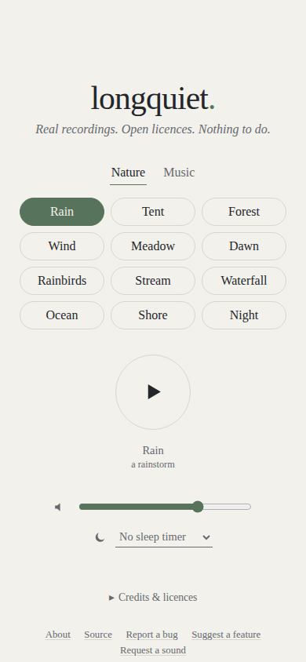

# longquiet

Field recordings and music, openly licensed, for long hours of quiet.

**<https://cameronbrooks11.github.io/longquiet/>**

[](https://github.com/CameronBrooks11/longquiet/actions/workflows/deploy.yml)
[](LICENSE)

<picture>
  <source media="(prefers-color-scheme: dark)" srcset="docs/phone-dark.png" />
  
</picture>

## What's in it

- **Nature:** 12 recordings, each a loop of 6 to 11 minutes that plays on with no gap: a rainstorm, heavy rain on a small tent, October woods, trees creaking in wind, a summer meadow, a dawn chorus, birds singing in rain, a stream over stones, a distant waterfall, the Baltic Sea, a calm early-morning shore, and frogs and crickets at night.
- **Music:** two playlists of solo pieces. Piano: 11 pieces, 54 min of Chopin's nocturnes. Guitar: 15 pieces, 73 min, Renaissance to modern.

Every recording is CC0, CC BY or CC BY-SA, and credited in the app.

## How to use it

- Tap a sound and it plays. Tap another to switch; Play pauses and resumes.
- A playlist lists its pieces under the controls: tap one to play it. It remembers where you were.
- Set the sleep timer and the sound fades out and stops when it runs out.
- Under Offline listening, save a sound and it plays with no connection; Remove frees the space.
- On a phone, the lock screen shows what is playing, with play and pause, and next and previous for a playlist.
- To keep it on your home screen: in Safari, Share → Add to Home Screen; in Chrome, the menu's Add to Home screen.

## Privacy

No accounts, no ads, no tracking, no backend. The page and the audio are static files served by GitHub Pages, which sees requests as any web host does. Your choice of sound, your volume and your place in each playlist are kept in your browser's local storage, and sounds you save for offline in its cache; nothing is sent anywhere.

## Credits

Most recordings are CC0. The rest are CC BY or CC BY-SA, which ask for credit and, for CC BY-SA, that the processed copy carries the same licence. Every file's source, author, licence and the changes made to it are in the app under Credits & licences, and in [sounds/CREDITS.md](sounds/CREDITS.md), which is generated from [sounds/sounds.json](sounds/sounds.json).

Found a problem, or know a recording that belongs here? [Report a bug](https://github.com/CameronBrooks11/longquiet/issues/new?template=bug.yml), [suggest a feature](https://github.com/CameronBrooks11/longquiet/issues/new?template=feature.yml) or [request a sound](https://github.com/CameronBrooks11/longquiet/issues/new?template=sound.yml).

## Development

Needs Node (version in `.nvmrc`) and [just](https://github.com/casey/just). `just --list` shows every recipe; the everyday ones:

```sh
just setup        # install dependencies
just fetch-audio  # download the audio release into public/audio/ (once)
just run          # dev server at http://localhost:5173/longquiet/
just check        # format check, lint, typecheck
just test         # unit tests
just build        # static site in dist/
```

Pushing to `main` deploys to GitHub Pages. [AGENTS.md](AGENTS.md) has the project's conventions, and [sounds/README.md](sounds/README.md) how sounds are chosen, built from their originals and published.

## Licence

Code: [MIT](LICENSE). Recordings: the licence listed for each in [sounds/CREDITS.md](sounds/CREDITS.md).
